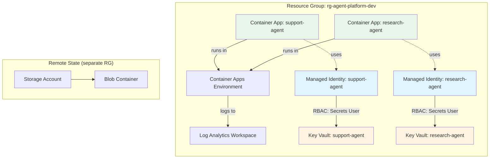

# Azure Agent Platform with Terraform

A Terraform-based platform for deploying AI agents on Azure with security and isolation built-in. Each agent gets its own managed identity, Key Vault, and Container App, following the "paved road" pattern for self-service infrastructure.

---

## Status

| Component | Status | Description |
|-----------|--------|-------------|
| **Bootstrap** | ✅ Built, ⏸️ Not Applied | Remote state storage in Azure Blob |
| **Platform Module** | ✅ Built, ⏸️ Not Applied | Shared infrastructure (RG, Log Analytics, Container Apps env) |
| **Workload Module** | ✅ Built, ⏸️ Not Applied | Per-agent resources (identity, vault, container app) |
| **Dev Environment** | ✅ Built, ⏸️ Not Applied | 2 agents defined, 13 resources planned |
| **Staging/Prod** | 📋 Designed Only | Structure defined, not implemented |
| **CI/CD** | 📋 Next Step | Atlantis/GitHub Actions integration |
| **Developer Access** | 📋 Next Step | Role assignments for secrets management |

**Current state:** All infrastructure is planned and validated (`terraform plan` succeeds). Nothing has been applied to Azure yet. The project demonstrates infrastructure-as-code patterns and security design, ready to deploy.

---

## Architecture



**Security isolation:** Each agent's managed identity has scoped RBAC access only to its own Key Vault. `support-agent` identity cannot access `research-agent` vault, and vice versa.

---

## Security Model

**Least privilege by design:**

- Each agent has its own **managed identity** (no credentials to manage)
- Each agent has its own **Key Vault** for secrets
- **Role assignments** grant each identity read-only access to its own vault only
- Agents **cannot access other agents' vaults** (scoped RBAC)
- Container Apps run with identities attached (identity-based authentication)
- **No secrets in Terraform** state or code

**Example:** `support-agent` identity can read `kv-support-agent` secrets, but has zero permissions on `kv-research-agent`.

---

## Key Decisions

### Why Azure Container Apps?

**Over AKS:**
- Simpler (no cluster management, no node pools, no kubectl)
- Scale to zero (no cost when idle)
- Built-in ingress, secrets, and Dapr

**Over VMs/Functions:**
- Container Apps are designed for long-running services
- Better for AI agents that need persistent connections

**Trade-off:** Less control than Kubernetes, but 90% simpler for microservices.

---

### Why Managed Identities?

**Over Service Principals:**
- No credentials to rotate or secure
- Automatically cleaned up when resource is deleted
- Simpler than managing client secrets

**Azure handles all authentication** — app code just uses `DefaultAzureCredential()`.

---

### Why RBAC for Key Vault?

**Over Access Policies:**
- Consistent with rest of Azure (same permission model)
- Easier to audit (all role assignments in one place)
- Standard roles ("Key Vault Secrets User", etc.)

**RBAC is the modern Azure standard.**

---

### Why One Resource Group?

**Over separate RGs per agent:**
- Simpler to manage and visualize
- Tag-based filtering for per-agent costs
- Faster resource creation (no RG creation per agent)

**Trade-off:** All agents in one RG means one access boundary. For strict isolation, could use RG-per-agent.

---

### Why Remote State?

**Over local state:**
- Team collaboration (shared state)
- State locking (prevents concurrent modifications)
- Backup and versioning (blob versioning enabled)
- No secrets on developer laptops

**Bootstrap uses local state** (chicken-and-egg problem), but everything else uses remote state.

---

## The Paved Road Pattern

**What it means:** Pre-approved, standardized way to deploy infrastructure.

**How it works:**

1. **User adds an agent** (data scientist, developer):
   ```hcl
   # In terraform.tfvars
   agents = {
     "my-new-agent" = {
       container_image = "myregistry.azurecr.io/my-agent:latest"
       cpu             = 1.0
       memory          = "2Gi"
       # ...
     }
   }
   ```

2. **Terraform creates everything automatically:**
   - ✅ Managed identity (auto-named: `id-my-new-agent`)
   - ✅ Key Vault (globally unique: `kv-my-new-agent-xyz123`)
   - ✅ Role assignment (least privilege: read own vault only)
   - ✅ Container App (identity attached, scale to zero)
   - ✅ Tags, naming, logging all consistent

**Platform team controls HOW** (modules define security and config).  
**Users control WHICH** (just add a map entry).

---

## AWS to Azure Mapping

| Concept | AWS | Azure | Notes |
|---------|-----|-------|-------|
| **Identity** | IAM Role | Managed Identity | Both attached to compute resources |
| **Secrets** | Secrets Manager | Key Vault | Azure has tighter RBAC integration |
| **Permissions** | IAM Policy | Role Assignment (RBAC) | Azure uses role-based, not policy-based |
| **Containers** | ECS Fargate | Container Apps | Azure has better scale-to-zero |
| **Logging** | CloudWatch Logs | Log Analytics | Azure has more powerful query language (KQL) |
| **State Storage** | S3 + DynamoDB | Blob Storage (built-in locking) | Azure simpler (no separate lock table) |
| **Resource Grouping** | Tags | Resource Groups (mandatory) | Azure enforces grouping, AWS is optional |

**Coming from AWS?** Managed Identity = IAM Role, Key Vault = Secrets Manager, Container Apps = Fargate.

---

## Project Structure

```
.
├── bootstrap/                    # Remote state storage (local state)
│   ├── main.tf                   # Storage account + container
│   ├── variables.tf
│   ├── outputs.tf
│   └── terraform.tfvars.example
│
├── modules/
│   ├── agent-platform/           # Shared infrastructure (called once)
│   │   ├── main.tf               # RG, Log Analytics, Container Apps env
│   │   ├── variables.tf          # Inputs (location, retention, tags)
│   │   └── outputs.tf            # IDs for workload module
│   │
│   └── agent-workload/           # Per-agent resources (called via for_each)
│       ├── main.tf               # Identity, Key Vault, role, Container App
│       ├── variables.tf          # Inputs (agent name, image, CPU, memory)
│       └── outputs.tf            # Vault names, app URLs
│
├── envs/
│   └── dev/                      # Dev environment
│       ├── backend.tf            # Remote state config (Azure Blob)
│       ├── main.tf               # Calls platform + workload modules
│       ├── variables.tf          # Environment inputs
│       ├── terraform.tfvars      # Dev values (gitignored)
│       ├── terraform.tfvars.example
│       └── outputs.tf            # Agent URLs, vault names
```

---

## Getting Started

### Prerequisites

- Azure CLI (`az`) installed and logged in
- Terraform 1.0+ installed
- Personal Azure subscription (avoid employer subscriptions with policies)

### 1. Bootstrap (Remote State)

```bash
cd bootstrap

# Create storage for remote state
terraform init
terraform plan
terraform apply

# Note the outputs (storage account name, container name)
terraform output
```

### 2. Initialize Dev Environment

```bash
cd ../envs/dev

# Configure backend with bootstrap outputs
terraform init \
  -backend-config="resource_group_name=rg-terraform-state-dev" \
  -backend-config="storage_account_name=sttfstate<RANDOM>" \
  -backend-config="container_name=tfstate" \
  -backend-config="key=dev.tfstate"
```

### 3. Plan the Infrastructure

```bash
# Copy example vars
cp terraform.tfvars.example terraform.tfvars

# Edit terraform.tfvars with your subscription ID

# See what will be created
terraform plan
# Expected: 13 resources (3 platform + 5 per agent × 2 agents)
```

### 4. Apply (Optional)

```bash
terraform apply

# Get agent URLs
terraform output agent_urls
```

### 5. Add a Third Agent

```hcl
# In terraform.tfvars, add:
"analytics-agent" = {
  container_image     = "mcr.microsoft.com/azuredocs/containerapps-helloworld:latest"
  cpu                 = 0.5
  memory              = "1Gi"
  min_replicas        = 0
  max_replicas        = 3
  ingress_enabled     = true
  ingress_target_port = 80
}
```

```bash
terraform plan
# Only 5 new resources! Existing agents untouched.
```

---

## Cost Estimate

**If applied:**

| Resource | Cost (monthly) | Notes |
|----------|---------------|-------|
| Log Analytics | ~$2-5 | 1GB daily cap, 30-day retention |
| Container Apps (idle) | ~$0 | Scale to zero, pay per second |
| Container Apps (active) | ~$0.50/hr | 0.5 vCPU, 1Gi memory per agent |
| Key Vault | ~$0.03/vault | Standard tier, no operations cost for low usage |
| Storage (state) | ~$0.02 | Tiny state files |

**Total if idle:** ~$2-5/month  
**Total if running 24/7:** ~$720/month (2 agents × 0.5 CPU × $0.50/hr)

**Recommendation:** Use for learning/demos, then destroy. Scale-to-zero means you only pay when testing.

---

## Known Limitations

**Intentional (for learning/demo):**
- No VNet or private endpoints (agents have public ingress)
- No CI/CD integration (manual terraform apply)
- Placeholder container images (hello-world apps)
- No agent application code (infrastructure only)
- No ACR (Azure Container Registry) integration
- Dev environment only (staging/prod not implemented)
- No monitoring/alerting beyond logs

**For production, you'd add:**
- VNet with private endpoints (no public access)
- APIM gateway (API management)
- Azure Policy (enforce standards)
- CI/CD with GitHub Actions or Atlantis
- Private container registry (ACR)
- More restrictive RBAC (break-glass access)
- Monitoring dashboards and alerts
- Budget alerts and cost allocation tags

---

## What I'd Do Next

**If continuing this project:**

1. **Apply and test** — Create real resources, test agent deployment
2. **Developer access** — Add role assignments so developers can manage secrets
3. **Real agent example** — Python Flask app that reads from Key Vault
4. **CI/CD pipeline** — GitHub Actions or Atlantis for GitOps workflow
5. **Staging environment** — Copy envs/dev to envs/staging
6. **VNet integration** — Add VNet, private endpoints, APIM gateway
7. **Self-service portal** — Web UI → API → Terraform automation
8. **Observability** — Dashboards, alerts, distributed tracing
9. **Cost tracking** — Per-agent cost allocation and budget alerts
10. **Documentation** — Runbooks, disaster recovery procedures

---

## Interview Talking Points

**Key concepts this project demonstrates:**

- ✅ **Infrastructure as Code** (Terraform modules, reusable components)
- ✅ **Security by design** (managed identities, RBAC, least privilege)
- ✅ **Cloud platforms** (Azure, translatable to AWS)
- ✅ **Platform engineering** (paved road, self-service)
- ✅ **Module design** (inputs, outputs, dependencies)
- ✅ **State management** (remote state, locking, backend configuration)
- ✅ **for_each pattern** (stable, scalable resource creation)
- ✅ **Separation of concerns** (modules vs environments)

**Questions I can answer:**
- How does managed identity authentication work?
- Why use for_each instead of count?
- How would you make this self-service?
- What's the security model? (each agent isolated)
- How do modules communicate? (outputs → inputs)
- Why separate environments? (blast radius, different configs)

---

---

## Technologies

- **Terraform** 1.17+ (Infrastructure as Code)
- **Azure** (Cloud Platform)
  - Resource Groups
  - Container Apps
  - Key Vault (RBAC mode)
  - Log Analytics
  - Managed Identities
  - Azure AD (Entra ID)
- **Git** (Version control)
- **Azure CLI** (Authentication and management)

---

## License

MIT License - This is a learning project, use it however you want!

---

## Author

**Khurram Hayat** - Platform Engineering | SRE

- LinkedIn: [linkedin.com/in/mkhurramhk](https://www.linkedin.com/in/mkhurramhk/)
- GitHub: [github.com/khurram-de](https://github.com/khurram-de)
